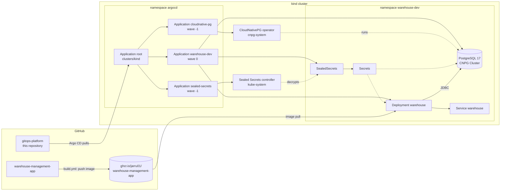

# gitops-platform

[](https://github.com/Jarru01/gitops-platform/actions/workflows/lint.yml)
[](https://github.com/Jarru01/gitops-platform/actions/workflows/e2e.yml)

GitOps delivery of [warehouse-management-app](https://github.com/Jarru01/warehouse-management-app)
(Spring Boot + PostgreSQL) to Kubernetes with Argo CD. Everything the cluster
runs is declared in this repository; Argo CD keeps the cluster in sync with it.

Every push and pull request is tested end to end: CI creates a kind cluster,
installs Argo CD, points it at the commit under test, waits until all
Applications are Synced and Healthy, and checks that the app's login page
answers with HTTP 200.

## How it fits together



1. `scripts/up.sh` creates the cluster, loads the Sealed Secrets key, installs
   Argo CD and applies one object: the root Application.
2. The root Application renders `clusters/kind`, which holds one Application
   per component (app-of-apps).
3. Sync waves order the rollout: the platform (wave -1) must be Healthy before
   the warehouse app (wave 0) is created. Inside the app, the SealedSecrets go
   first, then the database, then the Deployment and Service.

## Repository layout

| Path | Contents |
|---|---|
| `bootstrap/kind-config.yaml` | Single-node kind cluster, node image pinned by digest |
| `bootstrap/argocd/` | Argo CD install (pinned upstream manifest) plus a health check for child Applications |
| `bootstrap/root-app.yaml` | Root Application of the app-of-apps |
| `bootstrap/sealed-secrets/sealing-key.crt` | Public certificate the secrets are sealed with |
| `clusters/kind/` | Entry point for the kind cluster: platform + `warehouse-dev` |
| `platform/` | Argo CD Applications for the Sealed Secrets controller and the CloudNativePG operator (Helm charts) |
| `apps/warehouse/base/` | Deployment, Service, CloudNativePG `Cluster`, settings ConfigMap |
| `apps/warehouse/overlays/dev/` | Namespace `warehouse-dev`, image tag, dev settings, sealed credentials; deployed to kind |
| `apps/warehouse/overlays/prod/` | Namespace `warehouse-prod`, 2 app replicas, 2 PostgreSQL instances; rendered and validated by CI, not deployed yet (see Roadmap) |
| `scripts/` | `up.sh` (bootstrap), `wait-for-apps.sh`, `smoke-test.sh`, `seal-secrets.sh` |
| `.github/workflows/` | `lint.yml` and `e2e.yml` |

### Pinned versions

| Component | Version |
|---|---|
| Argo CD | v3.6.2 |
| CloudNativePG operator | v1.30.2 (Helm chart 0.29.2) |
| PostgreSQL image | `ghcr.io/cloudnative-pg/postgresql:17.11-system-trixie` |
| Sealed Secrets controller | v0.41.2 (Helm chart 2.22.0) |
| kind / node image | v0.33.0 / `kindest/node:v1.35.8` (digest-pinned) |
| CI tools | kubectl 1.35.8, kustomize 5.8.3, kubeconform 0.8.0, yamllint 1.38.0; binaries are checksum-verified, actions pinned by commit SHA |

## The warehouse app on Kubernetes

The settings come from the app's `prod` Spring profile
(`application-prod.yml`) and its `compose.yaml`:

| Variable | Source |
|---|---|
| `SPRING_PROFILES_ACTIVE=prod`, `DB_URL`, `PUBLIC_URL`, `MAIL_*` | ConfigMap `warehouse-config` (base + overlay) |
| `DB_USERNAME`, `DB_PASSWORD` | Secret `warehouse-db-credentials`, also used by CloudNativePG to create the database owner |
| `WAREHOUSE_RIADITEL_HESLO` (temporary director password) | Secret `warehouse-app-secrets` |

The Deployment runs as the image's non-root user (UID 10001) with a read-only
root filesystem, no capabilities and a `RuntimeDefault` seccomp profile. A
startup probe gives Spring Boot and Flyway time to start; the liveness probe
uses `/actuator/health/liveness` and the readiness probe
`/actuator/health/readiness`, which also checks the database.

Dev differences: no TLS in front of the app yet, so the session cookie is not
marked `Secure`; there is no mail server, so password-recovery e-mails are not
delivered.

## Run it locally

Requirements: Docker, [kind](https://kind.sigs.k8s.io/) v0.33.0, kubectl and
bash (Linux, macOS, or WSL on Windows). Argo CD pulls this repository from
GitHub, so the cluster runs what is pushed, not your local changes.

```bash
# The sealing private key (see "Secrets"); default location:
#   ~/.config/gitops-platform/sealed-secrets.key
scripts/up.sh                      # cluster, Argo CD, root app; waits until all apps are Healthy
scripts/smoke-test.sh              # port-forward + GET / must return 200
```

Deploy a branch or commit instead of `main`:

```bash
TARGET_REVISION=my-branch scripts/up.sh
```

Open the app at <http://localhost:8080> and sign in as the director with the
temporary password from the cluster:

```bash
kubectl -n warehouse-dev get secret warehouse-app-secrets \
  -o jsonpath='{.data.WAREHOUSE_RIADITEL_HESLO}' | base64 -d; echo
kubectl -n warehouse-dev port-forward service/warehouse 8080:80
```

Argo CD UI at <https://localhost:8443> (user `admin`):

```bash
kubectl -n argocd get secret argocd-initial-admin-secret \
  -o jsonpath='{.data.password}' | base64 -d; echo
kubectl -n argocd port-forward service/argocd-server 8443:443
```

Remove everything: `kind delete cluster --name gitops-platform`.

## Secrets

Credentials are committed only as
[Sealed Secrets](https://github.com/bitnami-labs/sealed-secrets): encrypted
with the public certificate `bootstrap/sealed-secrets/sealing-key.crt`, and
decrypted into ordinary Secrets inside the cluster by the controller that holds
the private key.

**Why Sealed Secrets and not SOPS:** Argo CD applies SealedSecret resources
like any other manifest, so it needs no plugin. SOPS would need KSOPS or a
custom Argo CD repo-server image to decrypt during rendering, which is more to
install and keep working in CI.

**Key handling:** a fresh kind cluster would normally generate a new key that
cannot decrypt the committed secrets. So the key pair is generated once, and
`scripts/up.sh` loads the private key into `kube-system` (labelled
`sealedsecrets.bitnami.com/sealed-secrets-key=active`) before the controller
starts; the controller adopts it, and automatic key renewal is off. The private
key is never committed: CI reads it from the repository secret
`SEALED_SECRETS_KEY`, local runs from `~/.config/gitops-platform/sealed-secrets.key`
or the path in `SEALED_SECRETS_KEY`.

**Using your own key** (for example in a fork):

```bash
mkdir -p ~/.config/gitops-platform
openssl req -x509 -nodes -newkey rsa:4096 -days 3650 \
  -subj "/CN=sealed-secret/O=sealed-secret" \
  -keyout ~/.config/gitops-platform/sealed-secrets.key \
  -out bootstrap/sealed-secrets/sealing-key.crt
scripts/seal-secrets.sh            # new random credentials for dev and prod, sealed with the new certificate
```

Commit the new certificate and `sealed-secrets.yaml` files, and store the
private key as the `SEALED_SECRETS_KEY` repository secret. Pull requests from
forks do not receive repository secrets, so their e2e run fails at the key step.

## CI

| Workflow | What it checks |
|---|---|
| [`lint.yml`](.github/workflows/lint.yml) | `yamllint --strict`; `kustomize build` of every kustomization validated with `kubeconform -strict` against Kubernetes 1.35.8 schemas and the CRD schemas of Argo CD, CloudNativePG and Sealed Secrets; `shellcheck` on the scripts |
| [`e2e.yml`](.github/workflows/e2e.yml) | `scripts/up.sh` on a kind cluster with Argo CD tracking the commit under test, waits until `root`, `sealed-secrets`, `cloudnative-pg` and `warehouse-dev` are Synced and Healthy, then `scripts/smoke-test.sh`; prints Applications, pods, events and logs on failure |

The image itself is built and pushed by
[`build.yml`](https://github.com/Jarru01/warehouse-management-app/blob/main/.github/workflows/build.yml)
in warehouse-management-app: every push to `main` is tagged `sha-<commit>` and
`latest`. The dev and prod overlays pin a `sha-` tag.

## Roadmap

- [x] **Phase 1:** kind + Argo CD app-of-apps, warehouse app with PostgreSQL
  (CloudNativePG) and sealed credentials, lint and e2e CI.
- [ ] **Phase 2:** automated image-tag pull requests when warehouse-management-app
  publishes a new image, and promotion from dev to prod through pull requests.
- [ ] **Phase 3:** ingress controller with TLS (cert-manager), Prometheus and
  Grafana for metrics and dashboards.
- [ ] **Phase 4:** deploy onto a real Kubernetes cluster on OpenStack provisioned
  with [Jarru01/terraform-openstack-minikube](https://github.com/Jarru01/terraform-openstack-minikube),
  with its own sealing key.

## License

[MIT](LICENSE)
